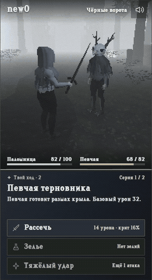

# new0 · У Чёрных ворот

<!-- prettier-ignore-start -->

<!-- technologies:start -->
[](https://github.com/omkality/new0-jrpg/actions/workflows/checks.yml)
[](https://www.typescriptlang.org/)
[](https://threejs.org/)
[](https://vite.dev/)
[](https://www.python.org/)
[](https://fastapi.tiangolo.com/)
[](https://docs.docker.com/compose/)
[](https://core.telegram.org/bots/webapps)
<!-- technologies:end -->

<!-- prettier-ignore-end -->

Портретная JRPG для Telegram. На лесной тропе паломницу встречает Певчая терновника. Из костяного клюва звучат два голоса. За воротами молчит колокол, а у железной решётки стоит причетник с секирой. Главу можно пройти поединками или сдержав данное в лесу слово.

Чтобы посмотреть главу на телефоне, нажми **«Играть» → «Автопрохождение»** в боте и держи телефон вертикально. За три минуты паломница покажет обмен оружием у ворот, выпьет зелье в бою с мимиком и дойдёт до помянника в костнице. [Открыть @new0_game в Telegram](https://t.me/new0_game)

[](docs/media/forest-chapter.mp4)

[Обмен оружием и бой с мимиком](docs/media/portrait-duels.mp4) · [Полное прохождение с тайниками и финалом в костнице](docs/media/forest-chapter.mp4) · [Правила главы и ориентиры для разработки](docs/PORTRAIT_SLICE.md)

На iPhone 16 в Telegram автопрохождение от 25 ноября 2026 года дало **59,96 FPS** в движении и боевых анимациях. Из 6 205 измеренных кадров четыре заняли больше 50 мс. В бою с мимиком все 489 кадров уложились в 25 мс. [Замеры по участкам и версия сборки](docs/VERIFICATION.md#портретная-глава)

## Первая глава на телефоне

Для ручного прохождения открой `/?chapter=forest` на адресе демо и нажми **«Играть»**. Стик ведёт паломницу, свайп поворачивает камеру. У корней можно подобрать зелье. На тропе нажми **«Заговорить»**. Певчая может поведать своё имя и попросить об обещании. Ответ меняет встречу и слова, которые ты услышишь в конце.

Если выбираешь бой, камера остаётся за плечом паломницы. Две обычные атаки готовят сильный приём. Мечом можно провести тяжёлый удар, копьём сделать выпад, секирой расколоть защиту. Перед ходом видны намерение противника и урон. Шанс крита у меча 16%, у копья 12%, у секиры 20%. Крит умножает урон на 1,5. На крите и при добивании врага в месте попадания появляются тёмные брызги.

Причетник пропустит в часовню за пять монет или после поединка. Победив его, можно осмотреть секиру у тела. Карточка сравнивает обычный урон, шанс крита и урон приёма с оружием в руке. Взял секиру, а позже передумал? Вернись на то же место и подбери прежнее оружие. У могилы с копьём действует тот же обмен.

На каменном подножии подсвечника в часовне стоит зелёный флакон. Зелье регенерации возвращает до 12 HP при глотке и ещё по 12 на двух следующих ходах этого боя. Дальше у западной стены стоит сундук с тёплым замком. Его можно обойти или поднять крышку и встретиться с мимиком.

Подбери ключ с каменной плиты и пройди через ворота. Присмотрись к ярму колокола и зарубкам у западной стены. В часовне лежат ключ от ризницы и след пропавшего певчего. Вернув язык колокола, ты выбираешь, позвать ли Певчую одним ударом или разбудить весь двор тремя. Звон поднимает дальнюю решётку часовни. В костнице можно направить свет из потолочного окна на стёртые надписи и решить судьбу последнего певчего. Темп чтения и хода задаёшь ты. Звук включает кнопка с динамиком. Музыку для игры напишет Даня.

## Запуск локально

Нужен Docker Engine или Docker Desktop с Linux containers и Compose **2.24.4+**.
Если локального `.env` ещё нет, скопировать `.env.example`. Гостевой запуск
работает без токена бота, домена и VPS.

```powershell
docker compose up -d --build --wait
```

При стандартном порте открой [ручное прохождение](http://localhost:8085/?chapter=forest) или [автопрохождение с замером FPS](http://localhost:8085/?chapter=forest&check=1). Корневой адрес `/` запускает [прототип с боем в реальном времени](docs/REALTIME_SHOWCASE.md). Порт публикации меняется
через `WEB_PUBLISH_PORT`, внутренние порты через `WEB_PORT` и `API_PORT`.
nginx, Uvicorn и healthcheck используют эти же настройки. API отдельно не публикуется.
Healthcheck выполняет небольшой `wget`, интерпретатор Python для него не запускается.
Адреса, ссылки магазина/дропа, бот, TTL и параметры проверки настраиваются
в [.env.example](.env.example). Токен в клиент не передаётся.

```powershell
docker compose ps
docker compose down
```

`down` сохраняет постоянный том `game-data`. Не добавлять `-v`, если нужны результаты.
После изменения игры: `docker compose up -d --build --wait web`.

## Временная HTTPS-демка и Telegram

Для проверки используется отдельный Compose-проект и отдельный том данных.
Cloudflare Quick Tunnel выдаёт временный HTTPS-адрес без аренды VPS и домена.
Адрес работает, пока включены Docker, туннель и компьютер. После пересоздания
туннеля адрес может измениться. Для постоянного запуска нужен стабильный хостинг.

```powershell
python scripts/preview.py start
python scripts/preview.py url --chapter forest --autoplay
python scripts/preview.py bind --chapter forest --autoplay
```

`bind` проверяет HTTPS и актуального бота, настраивает кнопку «Играть» и
проверяет сохранённый адрес. Ему нужен `TELEGRAM_BOT_TOKEN` в локальном `.env`.
Для ручной главы используй `url --chapter forest` и `bind --chapter forest`.
В конце автопрохождения дождись надписи **«Отчёт сохранён»**. Команда
`python scripts/preview.py report` выведет последний отчёт. Для портретной главы
его формат называется `portrait-auto-1`. При сбое связи нажми **«Повторить отправку»**.
В обычном браузере замер можно скачать в JSON.
Скрипт передаёт настройки контейнеру и не печатает токен. `PREVIEW_PROJECT_NAME`
отделён от основного проекта даже при заданном `COMPOSE_PROJECT_NAME`.

```powershell
python scripts/preview.py status
python scripts/preview.py stop
```

Остановка сохраняет диагностические отчёты и данные отдельного тома.
Механизм описан в [документации Cloudflare](https://developers.cloudflare.com/tunnel/get-started/quick-tunnels/).

## Идентификация и призовой рейтинг

API проверяет подписанный Telegram `initData`. Отдельная гостевая сессия служит
проверке демки. Платформа Telegram определяет оформление и сенсорный путь,
но её клиентское значение не является защитой призового конкурса.

**Текущий локальный бой не участвует в призовом рейтинге.** До конкурса
нужны серверная проверка нового игрового ввода и отдельная версия правил.
Это отслеживается в [#9](https://github.com/omkality/new0-jrpg/issues/9).
Время прохождения не определяет победителя. Лимит попыток, ничьи, сроки и
условия допуска ещё согласуются с владельцем. Дашборд находится в очереди.

## Технологии и ассеты

Клиент написан на TypeScript и Three.js, собирается Vite. Сервер на Python и
FastAPI проверяет вход через Telegram и сохраняет диагностические отчёты.
Сессии и данные сервера хранятся в SQLite. nginx обслуживает статику и
проксирует API. Все сервисы запускаются Compose.

- [Персонажи Patch и производные](public/assets/cast/SOURCES.md), CC0. Базовые
  модели и скелеты дополнены облегающей одеждой и отдельной бронёй.
  [Лица на основе MakeHuman](public/assets/fixes2/appearance/NOTICE.md), CC0.
- [Боевые клипы и контракт](public/assets/motion/SOURCES.md): собственные атаки
  и реакции, направленные уклонения и падения, ретаргет движений Quaternius UAL
  (CC0). [Воспроизводимая подготовка](scripts/assets/README.md)
  проверяет стыки комбо, контакт с полом, деформацию и контракт движений.
- [PSX Dungeon by Goblinatron](https://goblinatron.itch.io/psx-dungeon), CC BY 4.0.
  PNG не изменены, применяются повторение, тонирование и освещение.
  [Источник и лицензия](public/assets/dungeon/SOURCES.md).
- [Сундуки, оружие, ключи, монеты и двери](public/assets/props-v7/SOURCES.md):
  сундук Rico Cilliers и материалы Poly Haven CC0, производные модели для демки.
- Зелья, кираса, чёрные ворота, архитектура, небо, растительность, интерфейс и временный звук созданы
  для демки. Кадры PRISON OF HUSKS служат референсами и не входят в игровые файлы.
- Неизменённая Mediabunny 1.66.0 используется только рекордером.
  [MPL-2.0 и исходный код](public/licenses/NOTICE.txt).
- Three.js и three-mesh-bvh распространяются с [MIT-уведомлениями](public/licenses/NOTICE.txt).
- [Ebbe Black](https://ofont.ru/view/5821), Dimitri Antonov / Blue Curve Designstudio,
  [SIL OFL 1.1](public/fonts/OFL.txt). Исходный TTF не изменён, находится локально.
  [Происхождение файла](public/fonts/SOURCES.txt).

Бейджи версий генерируются из файлов проекта. После смены зависимостей:
`python scripts/update_badges.py`. CI проверяет их актуальность. Счётчики
скачиваний, звёзд и неподтверждённые статусы релиза не показываются.

## Проверки разработки

Для локальных хуков нужны Python 3.12+ и Node.js 24+. В PowerShell:

```powershell
npm ci
python -m venv .venv
.venv/Scripts/python.exe -m pip install -r requirements-dev.txt
.venv/Scripts/python.exe -m pre_commit install --install-hooks
.venv/Scripts/python.exe -m pre_commit run --all-files
```

В Linux/macOS использовать `.venv/bin/python` вместо `.venv/Scripts/python.exe`.
Каждому новому клону нужна одна установка Git-хука. При коммите проверяются
подготовленные файлы. Если форматтер что-то исправил, просмотреть изменения,
повторить `git add` и коммит.

В `.pre-commit-config.yaml` зафиксированы версии общих хуков и Ruff.
`ruff-check` проверяет ошибки Python и порядок импортов, `ruff-format`
форматирует Python. Prettier из `package-lock.json` форматирует TypeScript,
JavaScript, CSS, HTML, JSON, YAML и Markdown. Дополнительно проверяются
типы TypeScript, бейджи, синтаксис данных, конфликты слияния, регистр путей,
символьные ссылки, приватные ключи и предел 3 МиБ на файл.

Compose-файлы используют `!override`, поэтому YAML-хук проверяет их синтаксис
с поддержкой нестандартного тега. Семантику Compose и запуск сервисов проверяет CI.
Исходные ассеты, лицензии и сгенерированные данные исключены из форматирования,
но остаются под проверками JSON, конфликтов и размера. Локальные `work/`, `.env`,
сборки и зависимости исключены Git. Тяжёлые проверки ассетов и Docker остаются
в CI, который также запускает все хуки по отслеживаемым файлам.

Полные проверки приложения:

Для хостовой сборки нужен Node.js 24+, для служебных скриптов Python 3.10+.

```powershell
npm ci
npm run build
npm test
docker compose --profile test run --build --rm tests
python scripts/update_badges.py --check
```

Клиентские тесты покрывают бой, ввод, контракт анимаций и расчёт диагностик.
API-тесты проверяют идентификацию, серверные правила и изоляцию отчётов.
Изолированный HTTP smoke API и работа нестандартных портов проверяются
через `python scripts/verify_compose.py`. Его временные данные отделены от игровых.
Фактические наблюдения и ограничения: [docs/VERIFICATION.md](docs/VERIFICATION.md).

Разработка идёт через ветки и PR в `dev`, согласованные этапы попадают в `master`.
Очередь и обратная связь находятся в GitHub Issues с приоритетами P0/P1/P2.
Текущая игровая итерация: [#1](https://github.com/omkality/new0-jrpg/issues/1).
